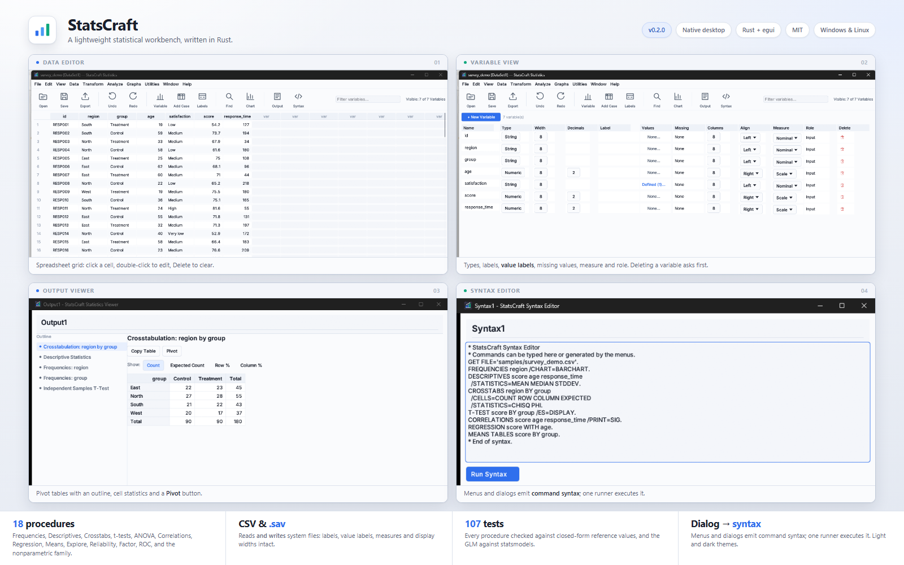

# StatsCraft

Lightweight statistical workbench written in Rust (native desktop app).

**Version 0.4.0** adds data preparation and output polish: Transform dialogs
(compute, recode, count, rank, automatic recode), Data prep (select, weight,
split, aggregate, add/match files, restructure), weighted and split analyses,
print output, session restore, and the 0.3 trustworthy editing layer (undo,
value labels, honest menus, scoped syntax, Log, `.scdoc`).



[](https://github.com/SarmaSaurav/statscraft/actions/workflows/build.yml)
[](https://github.com/SarmaSaurav/statscraft/releases/latest)

## Interface

The UI is a modern desktop workbench:

- **Typography** — bundled **IBM Plex Sans** (Regular / Medium / SemiBold /
  Bold) for UI copy and **JetBrains Mono** for syntax and log text, embedded
  in the binary so the app looks the same on every machine.
- **Icons** — a 39-glyph **SVG line-icon set** embedded in the binary.
  The ribbon uses large monochrome glyphs tinted from the active theme,
  with a readable label under each icon. Menu entries and tabs use the
  same set, so every surface stays consistent in light and dark mode.
  Regenerate with `python tools/build_icons.py`.
- **Palette** — two themes in `src/theme.rs`: a light slate-and-sky workbench
  and a dark theme with Dracula-inspired surfaces and a sky accent. The
  colours live in a struct rather than in constants, so the widgets and
  the style always agree, and the theme is switched from the **View**
  menu. `statscraft data.csv --dark` starts in the dark one.
- **App icon** — a rounded square in the Dracula background with three
  ascending bars and a rising plot line, embedded in the executable, in
  the installer and in the Start Menu shortcut.
- **The Data Editor edits** — cases can be added and deleted, cells and
  blocks of cells copied and pasted, and a variable's **missing values**
  declared as discrete values or as a range, which every procedure then
  leaves out.
- **Value labels from Variable View** — the Values column opens a
  dedicated editor for numeric and string labels. The row is not a dead
  cell any more: click `None.` or `Defined (n).`, add the mappings, and
  press OK.
- **Safe destructive actions** — deleting a variable uses a trash icon
  and asks for confirmation first. Closing the window with unsaved edits
  shows **Save / Don't Save / Cancel** instead of discarding them.
- **The Chart Builder** — the type of the chart, the variables, how the
  data is summarised, the title and the axis labels, and a reference
  line, with a live preview of the result.
- **Chrome** — rounded cards, soft shadows, zebra-striped grid, pill-shaped
  document tabs, hairline borders, and a proper primary button for *Run Syntax*.

## Procedure dialogs

A procedure does not run straight from the Analyze menu. It opens
a dialog:

- a **source variable list**, each row marked with a measure-level icon (a
  ruler for numeric/scale, a pencil for string/nominal);
- a **target list**, with an arrow to move a variable across and back;
- a right-hand column of **sub-dialog buttons** — `Statistics…`, `Charts…`,
  `Format…`, `Cells…`, `Post-hoc…`, `Options…`;
- procedure-specific checkboxes;
- **OK / Paste / Reset / Cancel / Help**, with OK disabled until the dialog
  has what it needs (and a grouping variable for t-test, ANOVA, means and
  crosstabs).

The dialog computes nothing — it **builds command syntax** and hands it to the
same runner the Syntax Editor uses. **OK** runs it; **Paste** puts it in
the Syntax Editor without running it, so you can edit the command by hand
first. That is the whole dialog → syntax → output pipeline, and it is why
the two editors and the menus behave identically.

Eighteen procedures have dialogs: Frequencies, Descriptives, Crosstabs,
Independent-Samples T Test, Paired-Samples T Test, One-Way ANOVA, General
Linear Model, Bivariate Correlations, Linear Regression, Means, Explore,
Reliability, Factor Analysis, ROC Curve, and the nonparametric family —
Mann-Whitney U, Kruskal-Wallis H, Wilcoxon signed-rank and Friedman.

The dialogs' options reach the statistics engine, not just the syntax:
`/STATISTICS=` chooses which descriptives are computed, `/CELLS=` gives
the crosstab its row, column and expected counts, `/POSTHOC=` adds the
ANOVA's Tukey, Scheffe, Bonferroni and LSD comparisons, `/ES=DISPLAY`
adds the t-test's effect sizes (Cohen's d, Hedges' g), and `/PRINT=SIG`
puts the significance stars on the correlation matrix.

To launch straight into a dialog, or to run a syntax file at start-up:

```sh
statscraft data.csv --dialog frequencies
statscraft data.csv --script run.sps
```

`docs/REFERENCE.md` records the reference behaviour that the dialogs are
modelled on.

## Install

Download the latest release from
**[GitHub Releases](https://github.com/SarmaSaurav/statscraft/releases/latest)**:

| Asset | What it is |
|---|---|
| `StatsCraftSetup.exe` | The Windows installer. One file, no prompts, no admin. |
| `statscraft-windows-x86_64.exe` | The Windows portable binary. |
| `statscraft_<version>_amd64.deb` | The Debian/Ubuntu package. |
| `statscraft-linux-x86_64` | The Linux portable binary. |

### Install (Windows)
Run `StatsCraftSetup.exe` — a single native installer (no archives, no prompts):
installs to `%LOCALAPPDATA%\Programs\StatsCraft` (no admin) and creates
Start Menu shortcuts: **StatsCraft** and **Uninstall StatsCraft**.
If StatsCraft is running, the installer closes it and replaces the binary.

## Install (Linux, .deb-first)
```sh
bash packaging/linux/build_deb.sh   # produces statscraft_<version>_<arch>.deb
sudo dpkg -i statscraft_*.deb       # integrates with application menus
```
A CI workflow (`.github/workflows/build.yml`) builds the Windows installer
and the Linux `.deb` on every push.

To run the same Linux build locally, without a Linux machine:

```sh
docker run --rm -v "$PWD:/repo" -w /repo rust:1.93-bookworm bash tools/ci_linux.sh
```

That builds the app, builds the `.deb`, prints the package's metadata and
runs the test suite — the same steps the CI runs.

## Run from source
```sh
cargo run
```
Optional: `cargo run -- path\to\data.csv`

## Build (release)
```sh
cargo build --release        # app
cd installer && cargo build --release   # Windows installer (embeds the app exe)
```

## Architecture (locked-in decisions)
- **Stack**: Rust + egui/eframe, one codebase for Windows + Linux, fully
  custom-drawn UI.
- **Pipeline**: UI and dialogs generate **syntax**
  commands → the syntax runner executes them → analyses emit **pivot-table
  models** shown in the Output Viewer. GUI and syntax editing stay consistent.
- **Windows packaging**: prebuilt native installer (`installer/` crate).
- **Linux packaging**: `.deb` first (Ubuntu/Debian), AppImage optional later.
- **Dependencies**: polars is kept (70 MB binary is acceptable) for `.sav`
  loading via polars-readstat-rs.

## Features
- Load CSV and `.sav` files (labels, value labels, measure, alignment,
  decimals, user-missing), and **write** `.sav` back out with the labels,
  the value labels, the measures and the display widths intact
- Procedures: Descriptives, Frequencies, Correlations, Linear Regression,
  Independent-Samples T Test, Paired-Samples T Test, One-Way ANOVA,
  Crosstabs with Pearson Chi-Square, as a real **pivot table** with the
  totals as levels of the dimensions, the measures of a cell and a
  **Pivot** button that exchanges the row and the column dimensions,
  **General Linear Model** (factorial
  ANOVA with the three types of sums of squares), **Reliability
  (Cronbach's alpha)**,
  **Factor Analysis (principal components)**, **ROC curves**, **Means**,
  **Explore**, and the **nonparametric** family (Mann-Whitney U,
  Kruskal-Wallis H, Wilcoxon signed-rank, Friedman)
- Data Editor (Data View / Variable View tabs, variable filter)
- Variable View with the full variable column set (Name…Role)
- Multi-window documents: Data Editor (main window), Output Viewer and
  Syntax Editor in separate OS windows
- Output Viewer with pivot tables, outline pane, and Markdown/HTML export
- Sort Cases, export data (CSV), file dialogs
- Syntax runner:
  `LOAD`/`GET`, `CLEAR`, `DESCRIPTIVES`, `FREQUENCIES`, `CORRELATIONS`,
  `REGRESSION y WITH x`, `T-TEST y BY g`, `T-TEST PAIRED v1 v2`,
  `ONEWAY y BY factor`, `CROSSTABS a BY b`, `SORT CASES BY v (A|D)`,
  `MEANS TABLES`, `EXPLORE`, `RELIABILITY`/`ALPHA`, `FACTOR`, `ROC`,
  `COMPUTE`
- Computed variables with `COMPUTE name = expression` — the arithmetic
  operators plus `MEAN`, `MIN`, `MAX`, `SUM`, `ABS`, `SQRT`, `LN`, `LOG10`
  and `ROUND`
- Output Viewer charts: bar, histogram, scatter, box plot, ROC curve

## Validation
Every procedure is covered by reference tests (`cargo test`, 107 tests), checked against
closed-form/textbook values rather than against itself: sample mean/SD (n−1),
unit correlations and exact regression recovery, Pearson χ² on a hand-computed
contingency table, One-Way ANOVA F with known SS/df, Welch's t with unequal
variances, paired t on known differences, and user-missing exclusion through
the analysis pipeline.

The `.sav` writer is covered by a round-trip test: write the table, read it
back, and check the variables, the rows and the values match.

The Data Editor's editing is covered too: adding and deleting cases, the
shift of the cases after a deletion, pasting a block of values across the
columns, the missing values of a variable — both the discrete values and
the range — and writing value labels through the public data API.

See [`docs/FEATURE_GAP_PLAN.md`](docs/FEATURE_GAP_PLAN.md) for the honest
audit against the reference feature set, including the gaps that remain.

## Reference behavior
UI structure, menus, and analysis flow follow a classic desktop statistics design
(evidence gathered from the installed copy: menu resources, dialog→command
catalog, engine IPC). Numbers are validated against real-world sample datasets.

## Roadmap
See `PLAN.md`. The changes of each release are in
[`CHANGELOG.md`](CHANGELOG.md).
